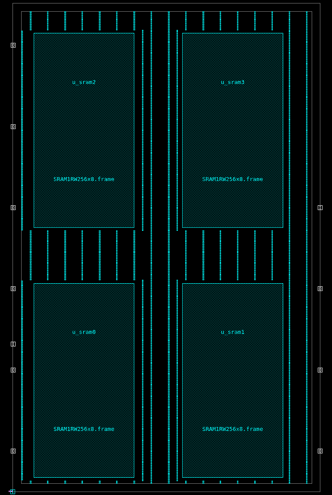
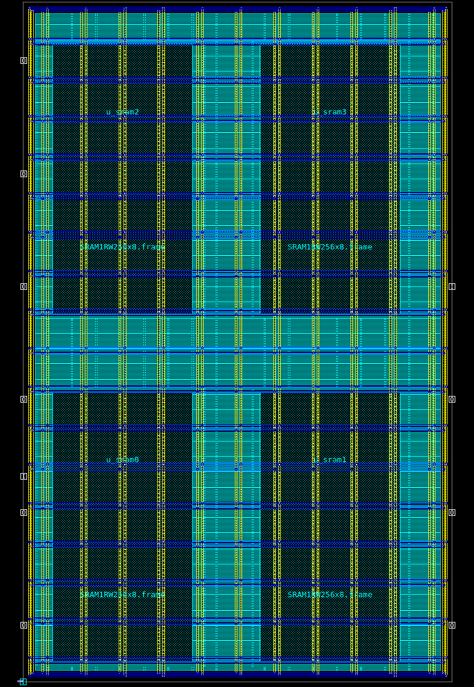
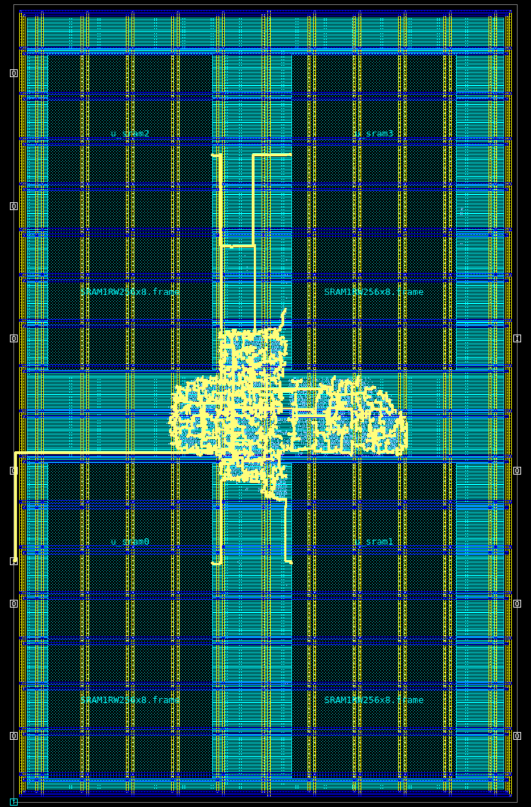
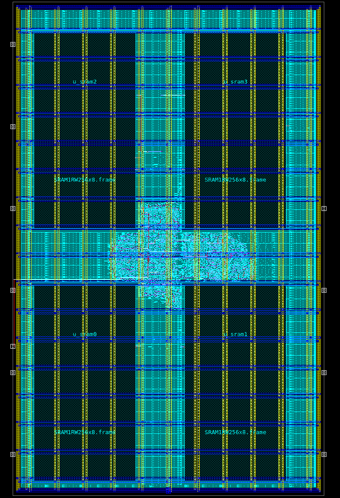

# RV32 SoC — RTL to GDSII on a 14 nm FinFET process

Full ASIC physical-design flow for a small RISC-V SoC with four SRAM hard macros,
taken from Verilog RTL to a routed, timing-signed-off layout using the Synopsys tool
chain on the SAED 14 nm FinFET educational PDK.

| | |
|---|---|
| **Design** | PicoRV32 (RV32I) core + 1 KB RAM (4 × `SRAM1RW256x8` macros) + boot ROM + GPIO |
| **Technology** | SAED 14 nm FinFET, 1P9M, multi-Vt (RVT / HVT / LVT) |
| **Target clock** | 250 MHz (4.0 ns) |
| **Tools** | VCS, Design Compiler, IC Compiler II, PrimeTime, IC Validator |
| **Result** | Timing met at all 3 signoff corners, LVS-clean in ICC2, PG grid DRC-clean |

---

## 1. Architecture

```
            ┌──────────────────────── rv32_soc ───────────────────────┐
 clk ──────►│                                                         │
 resetn ───►│  PicoRV32 ── mem bus ──┬── boot ROM (logic, 18 instr)   │
            │   RV32I                ├── SRAM1RW256x8  byte lane 0    │
 gpio[7:0]◄─│                        ├── SRAM1RW256x8  byte lane 1    │
 trap ◄─────│                        ├── SRAM1RW256x8  byte lane 2    │
            │                        ├── SRAM1RW256x8  byte lane 3    │
            │                        └── GPIO register                │
            └─────────────────────────────────────────────────────────┘
```

* **4 × 8-bit SRAMs instead of 1 × 32-bit:** RISC-V byte/half-word stores
  (`sb`/`sh`) need per-byte write enables; one macro per byte lane gives that
  and makes macro placement a real floorplanning problem.
* **Self-checking test:** the boot ROM sums 1..10, does word + byte writes to
  RAM, reads them back and writes `0xE2` to GPIO. VCS simulation: **PASS**.

## 2. Flow and results

| Stage | Tool | Key result |
|---|---|---|
| RTL simulation | VCS | Boot-ROM program passes (byte-lane writes verified) |
| Synthesis | DC (`compile_ultra`) | 6.9 k cells, 1,458 flops, timing met at 4 ns |
| Floorplan | ICC2 | Core 210 × 340 µm, 4 macros, 2 µm halos, 2,446 tap cells |
| Power plan | ICC2 | Ring + mesh + rails: **0 floating, 0 PG DRC** |
| Placement | ICC2 `place_opt` | Legal, 0 % congestion overflow, 33 % cells moved to HVT |
| CTS | ICC2 `clock_opt` | 1,458 sinks, 3 levels, 31 buffers, **skew 0.03 ns** |
| Routing | ICC2 `route_auto` / `route_opt` | 74 mm wire, 67 k vias, **0 opens / 0 shorts** |
| Signoff STA | PrimeTime + SPEF | **0 violations at 3 corners** |
| Physical verification | IC Validator | Scripts ready — blocked by license setup (see §6) |

### Signoff timing (PrimeTime, post-route SPEF, 6,634 nets annotated)

| Corner | PVT / RC | Setup WNS | Hold WNS | Violations |
|---|---|---|---|---|
| `ss` | 0.72 V, 125 °C, Cmax | +1.08 ns | +0.05 ns | 0 |
| `ssm40` | 0.72 V, **−40 °C**, Cmax | **+0.86 ns** (worst) | +0.07 ns | 0 |
| `ff` | 0.88 V, −40 °C, Cmin | +1.89 ns | **+0.01 ns** (worst) | 0 |

* Worst overall path: `resetn` input → `mem_wdata` flops (synchronous reset
  fan-out tree + 40 % I/O budget).
* Worst register-to-register path: +1.61 ns in PT vs +1.64 ns in ICC2 —
  **tools correlate within 30 ps**.
* **Temperature inversion observed:** at 0.72 V the design is *slower* at −40 °C
  than at 125 °C — the FinFET effect that makes cold-corner setup checks mandatory.

### Power (ICC2, ss / 125 °C / 250 MHz)

| Internal | Switching | Leakage | **Total** |
|---|---|---|---|
| 5.51 mW | 0.19 mW | 0.88 mW | **6.57 mW** |

## 3. Floorplan

```
 ┌──────────────── core 210 x 340 um ─────────────────┐
 │ [SRAM2  MY]  ◄── 35 um channel ──►  [SRAM3  R0]    │
 │                                                    │
 │ ════════ middle band: CPU standard cells ════════  │
 │                                                    │
 │ [SRAM0  MY]  ◄── 35 um channel ──►  [SRAM1  R0]    │
 └────────────────────────────────────────────────────┘
   I/O pins: left/right edges, M5/M6
```

* SRAM signal pins are on **M6**: 20 inputs on the left edge, 8 outputs on the right.
  Left-column macros are **mirrored (MY)** so their input pins face the centre channel.
* 2 µm hard keep-out (halo) around each macro for pin access.

| Floorplan (macros, tap cells, I/O pins) | Power grid (ring, M7/M8 mesh, M1 rails) |
|---|---|
|  |  |
| **Clock tree** (41 clock nets highlighted; reaches 1,458 flops + 4 SRAM `CE` pins) | **Final routed layout** |
|  |  |

Close-up of the clock tree over the logic area: [docs/clock_tree_zoom.png](docs/clock_tree_zoom.png)

## 4. Power delivery network — and how it was debugged

Final PDN: **M7/M8 core ring + mesh (1 µm straps, VDD/VSS pairs every 20 µm),
M1 standard-cell rails, stacked vias M7→M1.** The mesh also runs over the SRAMs
and drops directly onto their M6 power pins.

Getting it DRC-clean took five iterations, each traced to a tech-file rule:

| # | Symptom (`check_pg_connectivity` / `check_pg_drc`) | Root cause | Fix |
|---|---|---|---|
| 1 | All std cells floating | M1 and M7 not adjacent → `compile_pg` adds no stacked vias | `create_pg_vias` M7→M1 |
| 2 | 3,812 VIA6 spacing errors | `sameSegAlignedCutMinSpacing = 0.07` vs default array 0.05 | Custom via master |
| 3 | M6 min-width / VIA5-VIA6 misalignment | Single cut → tiny pad; unequal arrays → cuts not stacked | **Identical 8×1 VIA5 & VIA6 arrays @ 0.07 µm** |
| 4 | Thin M4/M5 mesh trial: M2 min-area + VIA2/VIA3 errors (22 k) | Narrow straps → cut-sized pads | Abandoned; back to wide M7/M8 |
| 5 | 234 VSS rail pieces floating | Interleaved straps missed the 13 µm side margins | VDD/VSS **pairs** at offset 4 µm |

## 5. Other issues found and fixed

* **Unintended latches** — PicoRV32 uses `(* full_case *)` (Yosys syntax), which DC
  ignores → 68 latch bits. Fixed with `// synopsys full_case` on that `case`.
* **SRAM simulation model** — vendor `saed14sram.v` does not compile in VCS
  (signal used before declaration) → equivalent clean model in `tb/`.
* **VDD open in LVS check** — (a) PG ports had no pin shapes → `create_terminal` on
  the M8 ring; (b) open locations all sat on `FILLP2`/`FILLP3` special fillers whose
  PG pins don't continue the rail → plain `FILL*` cells only → **0 opens**.
* **2,726 `min_capacitance` DRVs at the ff corner** — slack rounds to 0.00 ns, caused
  by library min-load characterization at ff/−40 °C; reviewed and waived.

## 6. Known limitations

* **IC Validator DRC/LVS not run** — ICV on the workstation fails to reach its
  license manager. `run_drc.sh` / `run_lvs.sh` are ready. ICC2 reports 191 detail-route
  DRC markers (mostly non-preferred-direction and end-of-line) to be confirmed or
  cleared against the foundry deck.
* The −40 °C setup corner reuses the 125 °C Cmax SPEF (approximation).
* SDC uses a simple 40 % I/O budget; a real SoC would take budgets from the top level.

## 7. Repository layout and how to run

```
rtl/       rv32_soc.v (top), picorv32.v (YosysHQ, ISC license, 1 pragma added)
tb/        tb_rv32_soc.v, sram_sim_model.v
cons/      rv32_soc.sdc
scripts/   common_setup.tcl   all PDK paths, corners, libs
           run_sim.sh         VCS
           dc_syn.tcl         Design Compiler
           icc2_01_init.tcl   library, netlist, MCMM
           icc2_02_floorplan.tcl
           icc2_03_powerplan.tcl
           icc2_04_place.tcl
           icc2_05_cts.tcl
           icc2_06_route.tcl
           icc2_07_finish.tcl PG pins, fillers, final outputs
           pt_sta.tcl         PrimeTime, CORNER=ss|ssm40|ff
           run_drc.sh / run_lvs.sh   IC Validator
docs/      layout screenshots
```

```bash
bash scripts/run_sim.sh
cd syn && dc_shell -f ../scripts/dc_syn.tcl
cd pnr && for s in 01_init 02_floorplan 03_powerplan 04_place 05_cts 06_route 07_finish; do
    icc2_shell -f ../scripts/icc2_$s.tcl < /dev/null > icc2_$s.log 2>&1; done
cd sta && for c in ss ssm40 ff; do CORNER=$c pt_shell -f ../scripts/pt_sta.tcl; done
```

PDK files, GDS and SPEF are not included (SAED PDK and SRAM layouts are licensed IP).

## Credits

* PicoRV32 by Claire Xenia Wolf / YosysHQ — https://github.com/YosysHQ/picorv32 (ISC license)
* SAED 14 nm EDK — Synopsys Armenia Educational Department
